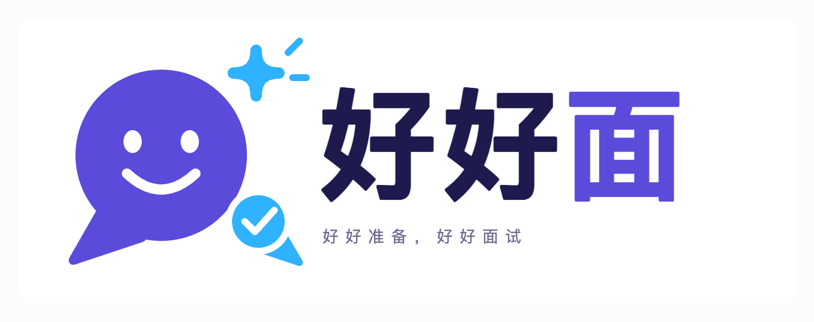

<p align="center"></p>

# 好好面

### 好好准备，好好面试。

把面试题导进来，把答案说出来。录音、复盘、收藏，一场练习完成。

**每练一次，都有收获。**

[下载本地体验版](https://github.com/Clara-Kyp/haohaomian/releases/latest/download/haohaomian-local.zip) · [产品首页](https://clara-kyp.github.io/haohaomian/) · [本地使用指南](docs/local-setup.md)

## 面试前，准备更到位

粘贴题单、上传面经截图，或根据岗位 JD 生成问题。选好简历和目标岗位，核对题目与顺序，开始练习。

## 作答时，按自己的节奏

点击播放题目，手动开始和结束录音。转写后直接校对，确认并进入下一题。想深入一点，主动生成追问；想换个说法，查看参考答案或获取改进思路。

## 练完后，看清亮点和差距

整场六维报告，评分理由、回答亮点、不足与原文依据一起看。回到作答区修改，再手动重新评估。

## 好的回答，随时拿出来复习

收藏自己的认可答案和 AI 参考答案。题目、目标岗位和答案一起保存，集中复习。每次收藏都是独立快照，后续修改互不覆盖。

## 一套工作台，覆盖完整练习

| 功能 | 怎么用 |
| --- | --- |
| 简历与岗位 | 为不同求职方向准备对应资料 |
| 题单导入 | 手动输入、截图识别、根据 JD 出题 |
| 录音作答 | 播放题目、选择麦克风、回听、转写校对 |
| 主动追问 | 围绕当前回答继续练习 |
| 参考答案与重答 | 查看结构化参考，按自己的经历重新表达 |
| 整场报告 | 六维分析、亮点不足、原文核对 |
| 我的收藏 | 保存好答案，面试前集中复习 |
| 录音复盘 | 导入整段录音，整理并核对问答 |
| 本地体验 | 无需注册，练习资料保存在自己的电脑 |

## 快速开始

**下载、解压，在自己的电脑上开始练习。无需注册和邀请码。**

1. [下载本地体验版 ZIP](https://github.com/Clara-Kyp/haohaomian/releases/latest/download/haohaomian-local.zip)，解压到一个固定目录。
2. 安装 [Node.js 24 LTS](https://nodejs.org/zh-cn/download) 和 [FFmpeg](https://ffmpeg.org/download.html)。
3. 在解压目录打开终端，运行：

```sh
npm ci
npm run local
```

打开 **http://localhost:3000/workspace**。以后使用，只需在同一目录运行 `npm run local`；停止时按 `Ctrl+C`。

这是需要 Node.js 环境的本地源码体验版。详细安装步骤和常见问题见[本地使用指南](docs/local-setup.md)。已有 Docker 的用户也可按指南直接启动，无需单独安装 Node.js 和 FFmpeg。

在「模型设置」填写自己的模型与 API Key，即可使用 AI 出题、参考答案、转写和报告。对话、图片支持阿里云百炼、Kimi、MiniMax 和 OpenAI；语音转写支持 MiniMax 和阿里云。服务费用由对应模型服务商收取。

练习、录音、收藏和模型配置保存在本机 `data/` 目录。使用 AI 功能时，相关材料会发送到你配置的模型服务商。升级时保留完整的 `data/`，包括 `workspace/.key`。

GitHub Pages 提供产品介绍和下载入口。完整练习在本机运行。需要自行部署多人版本时，可参考[部署指南](docs/deployment.md)。

## 开发与测试

前端：React + Vite + TypeScript。后端：Node.js + Express。工作台使用按账户隔离的 JSON 和文件存储，账户使用 SQLite。

```sh
npx playwright install chromium
npm test
```

可通过 `CHROME_PATH` 使用已安装的 Chrome。测试使用独立临时数据目录。

## 开源协议

[MIT](LICENSE)。欢迎提交问题和改进建议。
